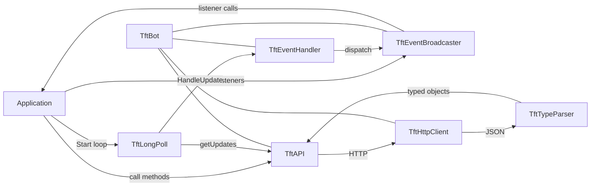

# Architecture

## Overview

fastTelega is layered around a small facade (`TftBot`) that owns the HTTP
transport, the Bot API client, the event broadcaster and the update dispatcher.

## Units

| Unit | Responsibility |
|---|---|
| `fastTelega.Bot` | Facade. Creates and owns the HTTP client, API, broadcaster and dispatcher. Exposes `Token`, `API`, `Events`, `EventHandler`. |
| `fastTelega.API` | 185 Bot API request methods, request serialization and response parsing. |
| `fastTelega.Net.HttpClient` | Thin wrapper over `TNetHTTPClient` for GET, form POST and multipart POST. |
| `fastTelega.Net.LongPoll` | Offset management and `getUpdates` loop. |
| `fastTelega.Events.EventBroadcaster` | Listener registry and synchronous broadcast. |
| `fastTelega.Events.EventHandler` | Maps `TftUpdate` members to broadcaster events. |
| `fastTelega.Parser.TypeParser` | Hand-written serializers for outgoing objects and `Rest.JSON` based deserializers for responses. |
| `fastTelega.AvailableTypes` | Aggregate Telegram object model (chats, messages, users and Bot API 10.3 additions). |
| `fastTelega.AvailableTypes.*` | Individual object units used by the aggregate unit. |
| `fastTelega.Helpers.*` | Class helpers, including a `TftPreCheckoutQuery.From` helper. |
| `fastTelega.Components.VCL` | Experimental `TftTelegramBot` component. |
| `fastTelega.Net.Server.*` | Indy-based webhook server and legacy HTTP server scaffolding. |

## Request lifecycle

1. The application calls a method on `Bot.API`, for example
   `Bot.API.SendMessage(ChatId, Text)`.
2. `TftAPI` builds a `TStringList` (form fields) or `TMultipartFormData`
   (file upload) and sets the HTTP content type.
3. `TftHttpClient.MakeRequest` performs a GET or POST to
   `https://api.telegram.org/bot<token>/<method>`.
4. The raw response is passed to `TftTypeParser.ParseJson`, which creates a
   `TJSONObject`.
5. The method extracts `result` and converts it to a typed object with
   `TJSON.JsonToObject<T>` or returns a Boolean/string/integer.
6. The caller owns the returned object and must free it.

## Update lifecycle

1. `TftLongPoll.Start` calls `Bot.API.GetUpdates(LastUpdateId, Limit, Timeout, AllowedUpdates)`.
2. For every update, the offset is advanced and `TftEventHandler.HandleUpdate`
   is called.
3. `TftEventHandler` first broadcasts the whole update through `OnUpdate`.
4. It then checks `InlineQuery`, `ChosenInlineResult`, `CallbackQuery` and the
   message variants (message, edited, channel, business, guest), and
   broadcasts the matching typed event.
5. `TftEventBroadcaster` invokes every registered listener synchronously on the
   polling thread.

The dispatcher does not create threads. A slow listener blocks further updates
for that bot.

## Ownership and lifetime

| Object | Owner | Notes |
|---|---|---|
| `TftHttpClient` | `TftBot` | `TftAPI` borrows the client. |
| `TftAPI` | `TftBot` | `TftLongPoll` borrows it. |
| `TftEventBroadcaster` | `TftBot` | Reference passed to the handler. |
| `TftEventHandler` | `TftBot` | `TftLongPoll` and webhook servers borrow it. |
| Returned Telegram objects | Caller | Free objects returned by API methods when done. |
| `TList<T>` returned by API | Caller | The list does not own its elements; free elements separately. |
| `TftUpdateList` | Caller | `TObjectList<TftUpdate>`, owns updates; freed by the long-poll loop. |

Destroy `TftLongPoll` and webhook servers before `TftBot`; they only borrow
the API and event handler.

## Serialization

Outgoing requests use a hand-written JSON serializer in `TftTypeParser`.
Primitive fields are emitted with `AppendToJson`; nested objects and arrays use
`Parse*` methods. Strings beginning with `{` or `[` are treated as raw JSON, so
callers can pass pre-serialized fragments (used by `TftInputRichMessage`).

Responses are deserialized with `Rest.JSON`. The serializer is case-insensitive
for property names, but it does not convert `snake_case` JSON keys to
PascalCase properties automatically. Some Telegram fields may therefore remain
empty; see [Types](Types.md#json-mapping).

## Long polling vs webhooks

Two update sources are available: long polling (`TftLongPoll`) and webhooks
(`TftWebhookServer`, `TftWebhookLocalServer`, `TftWebhookTCPServer`). The
webhook server listens over plain HTTP; terminate TLS in a reverse proxy. See
[Webhooks](Webhooks.md).
